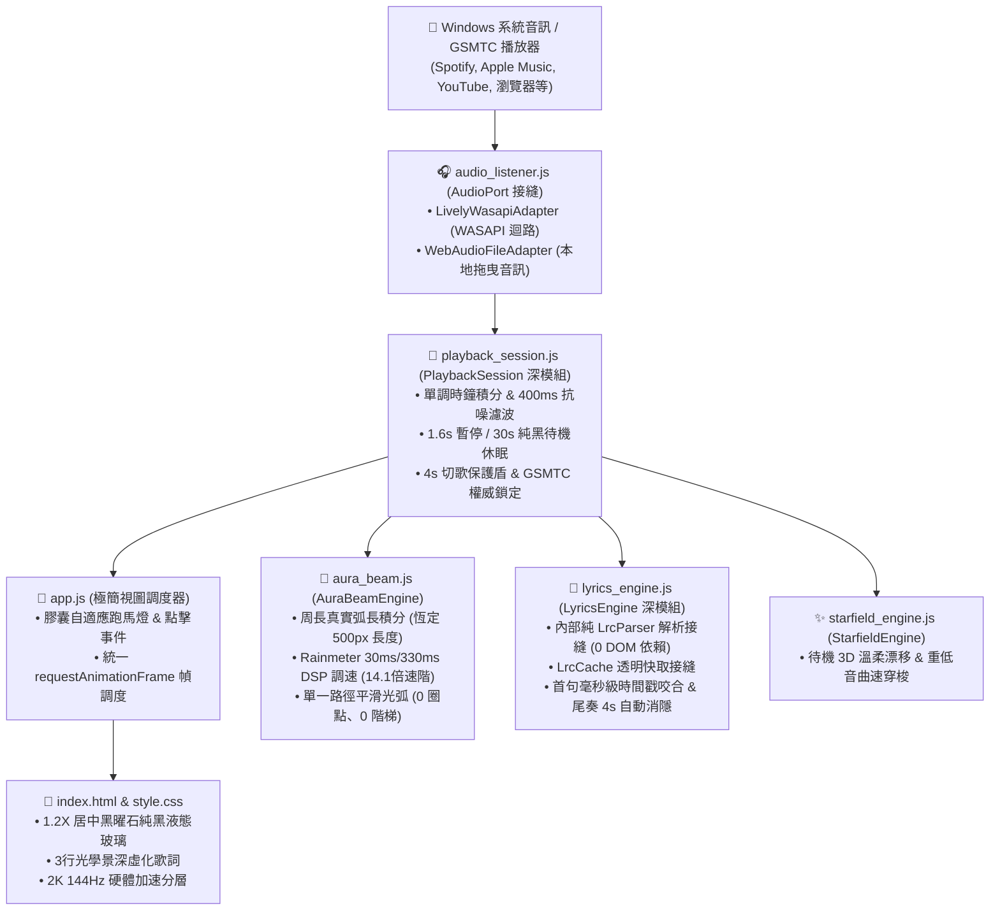

# 🎵 音樂AOD電腦桌布視覺播放器 (v1.3.1 深模組與效能優化版)

> **版本**：`v1.3.1 (Performance & Deep Modular Architecture)`  
> **作者**：`原來如此>_<`  
> **適用平台**：Windows 10 / 11 ✖ Lively Wallpaper ✖ WebView2  
> **授權協議**：MIT License  

---

## 🌟 一、 專案核心定位與設計哲學

本專案為 Windows PC 量身打造的**極致純黑（OLED AOD）黑曜石液態玻璃音樂視覺播放器**。採用 100% 純原生前端技術，兼具高幀率流暢動效與極致純淨的「0% GPU 待機負載」，適合作為 24/7 常駐的動態電腦桌布。



---

## 🛠️ 二、 開發技術棧與使用工具 (Tech Stack)

| 維度 | 技術 / 工具 | 選擇理由與優勢 |
| :--- | :--- | :--- |
| **結構核心** | 原生 HTML5 | 語意化標籤，結構純淨，無任何多餘框架負擔 |
| **視覺樣式** | Vanilla CSS3 | 採用 GPU Compositing Layer (`translateZ(0)`)，零 Reflow 抖動 |
| **向量渲染** | Canvas 2D API | 物理周長弧長參數化積分，繪製絲滑無瑕的 Google Chroma 雷射光軌 |
| **動態排版** | `ResizeObserver` | 歌曲名稱長短變化時毫秒級重測周長，光軌與膠囊 100% 精準貼合 |
| **音訊通訊** | WASAPI Loopback | Lively Wallpaper 原生 128 頻段音訊頻譜（低/中/高頻實時解析） |
| **媒體控制** | Windows GSMTC | 跨平台抓取 Spotify, Apple Music, YouTube, 瀏覽器當前曲目與歌手 |
| **在線歌詞** | LRCLIB REST API | 免費高速同步歌詞資料庫，支援精確 LRC 時間軸與純文字備援 |
| **字體排版** | Plus Jakarta Sans & Outfit | Google Fonts 頂級幾何無襯線字體，兼具科技感與極致易讀性 |

---

## 📂 三、 專案架構目錄與模組職責

```
Lively_AOD_Music_Hub/
├── CONTEXT.md                              # 領域模型名詞字典 (Playback Session, Track, Aura Beam, etc.)
├── LivelyInfo.json                         # Lively Wallpaper 詮釋資料 (標題、預覽圖、作者、啟動參數)
├── index.html                              # 主介面結構 (純黑背景、1.2X 膠囊、畫布、歌詞軌道)
├── README.md                               # 專案快速入門與特性簡介
├── ARCHITECTURE_AND_MAINTENANCE_GUIDE.md   # 【本文件】核心演算法、物理數學推導與日後維護規範
├── assets/
│   ├── preview.png                         # 範本待機模式預覽縮圖 (供 Lively Wallpaper 讀取)
│   ├── BM.jpg                              # 備用縮圖
│   └── demo_lyrics.lrc                     # 離線測試 LRC 歌詞範例檔
├── css/
│   └── style.css                           # 完整樣式表 (黑曜石晶體、光學景深歌詞、硬體加速分層)
└── js/
    ├── app.js                              # 極簡視圖調度器 (膠囊跑馬燈、事件綁定與動畫迴圈)
    ├── playback_session.js                 # 【深模組】狀態機、時鐘積分、400ms抗噪與30s待機休眠
    ├── lyrics_engine.js                    # 【深模組】LyricsEngine 3行景深歌詞、內部純 LrcParser/LrcCache
    ├── audio_listener.js                   # 【接縫】AudioPort 接縫與 Lively WASAPI / WebAudio 雙配接器
    ├── aura_beam.js                        # 【核心】AuraBeamEngine 周長等弧長光軌 ✖ Rainmeter DSP 調速
    └── starfield_engine.js                 # 【核心】StarfieldEngine 動態星空背景 (待機漂移 / 重低音曲速穿梭)
```

---

## 🔬 四、 核心物理與 DSP 數學演算法詳解

### 1. 物理周長等弧長參數化 (Arc-Length Parameterization)
* **解決問題**：徹底解決極坐標 CSS `conic-gradient` 在長條膠囊上的**開普勒「等面積速率」拉伸與轉彎縮水畸變**。
* **幾何推導**：
  設膠囊寬度為 $W$、高度為 $H$，兩端半圓半徑 $R = H / 2$，平直段長度 $L_{\text{straight}} = W - 2R$。
  總幾何周長 $P$ 為：
  $$P = 2(W - 2R) + 2\pi R = 2(W - H) + \pi H$$
* **分段坐標映射函數 $s \in [0, P) \mapsto (x(s), y(s))$**：
  1. **頂部水平段** ($0 \le s < L_1$)：$x = \text{pad} + R + s,\; y = \text{pad}$
  2. **右側半圓弧** ($L_1 \le s < L_1 + L_2$)：
     $$\theta = -\frac{\pi}{2} + \frac{s - L_1}{L_2}\pi \implies x = \text{pad} + (W - R) + R\cos\theta,\; y = \text{pad} + R + R\sin\theta$$
  3. **底部水平段** ($L_1 + L_2 \le s < L_1 + L_2 + L_3$)：$x = \text{pad} + (W - R) - (s - L_1 - L_2),\; y = \text{pad} + H$
  4. **左側半圓弧** ($L_1 + L_2 + L_3 \le s < P$)：
     $$\theta = \frac{\pi}{2} + \frac{s - L_1 - L_2 - L_3}{L_4}\pi \implies x = \text{pad} + R + R\cos\theta,\; y = \text{pad} + R + R\sin\theta$$
* **光弧長度**：永遠鎖定為 $L_{\text{beam}} = 0.35 \times P \approx 500\text{px}$，在直線與彎道上視覺長度 100% 恆定！

---

### 2. Rainmeter `AudioLevel` 雙時間常數（Attack/Decay）調速演算法
* **演算法架構**：
  $$\text{TargetBass} = (\text{RawBass})^{1.30}$$
  - **瞬態爆發 (Attack Phase，$\tau_{\text{att}} = 30\text{ ms}$)**：
    $$\text{SmoothedBass} \leftarrow \text{SmoothedBass} + (\text{TargetBass} - \text{SmoothedBass}) \cdot \min(1.0, \Delta t \cdot 32.0)$$
  - **慣性滑行 (Decay Phase，$\tau_{\text{dec}} = 330\text{ ms}$)**：
    $$\text{SmoothedBass} \leftarrow \text{SmoothedBass} + (\text{TargetBass} - \text{SmoothedBass}) \cdot \min(1.0, \Delta t \cdot 3.0)$$
* **實時物理線速度 $v(t)$（14.1 倍超大動態落差）**：
  $$v(t) = v_{\text{base}} + (\text{SmoothedBass} \times 1250.0) + (\text{SmoothedMid} \times 320.0)$$
  - 平緩巡航底限：$95\text{ px/s}$（無音樂時 $52\text{ px/s}$）
  - 大鼓炸裂上限：$1345 \sim 1665\text{ px/s}$（超強衝刺爆發力！）

---

### 3. 歌詞引擎 3 大痛點防護機制
1. **0ms 根節點極速銷毀**：
   切換新曲目時，在 `isNewSong` 判斷成功之瞬間同步調用 `lyricsEngine.purgePreviousSong()`，立即執行 `innerHTML = ''` 與 `AbortController.abort()`，徹底消除舊歌文字重疊。
2. **首句即時時間戳對齊**：
   非同步歌詞下載完成時，主動傳入即時 `playbackTime`，若歌曲在第 0~1 秒即開唱，立即咬合置中第 1 句，絕不漏句。
3. **結尾尾奏 100% 純黑消隱**：
   當 $t_{\text{effective}} > t_{\text{last}} + 4.0\text{s}$，自動為所有歌詞節點套用 `.is-outro-faded`（`opacity: 0`），使畫面平滑回歸純黑 `#000000`，徹底消除結尾虛化殘影。

---

## ⚠️ 五、 日後更新與二開維護「最高注意事項」(Maintenance Rules)

1. 🛡️ **禁止在 CSS 破壞坐標基準**：
   - `.liquid-glass-capsule-wrapper` 的 `padding` 必須保持為 `0`。
   - `AuraBeamEngine` 的幾何測量必須使用 `capsule.offsetWidth` 與 `offsetHeight`（未受 CSS `scale(1.2)` 縮放影響的原生 Layout 像素），嚴禁使用 `getBoundingClientRect()` 進行畫布樣式尺寸賦值，否則會觸發二次放大偏差！
2. 🛡️ **保持 0 圈點/0 刻度單一路徑繪製原則**：
   - 繪製內部微步時，`ctx.lineCap` 必須設為 `'butt'`，僅在頭尾極限消隱處做淡出，絕不能在中間區段使用 `'round'`，否則會產生彩色圓形珠狀節點。
3. 🛡️ **切歌狀態機的防誤觸原則**：
   - `onTrackUpdate` 必須嚴格比對 `songSig !== currentSongSignature`。Windows GSMTC 會在播放中途定期發送進度/縮圖事件，若未判斷簽名即無差別清空 DOM，會導致播放中途歌詞被清除。
4. 🛡️ **無框架純淨原則**：
   - 本專案嚴格保持純 HTML/CSS/JS 零依賴，嚴禁引入重量級 Node 模組或 React/Vue 構建鏈，確保 24/7 常駐執行記憶體低於 35MB、CPU 佔用近乎 0.0%。

## 💡 六、 Lively Wallpaper 桌布「暫停」完整設定指南 (FAQ & Pause Config)

在 Lively Wallpaper 中使用本網頁桌布時，若遇到「桌布不會自動暫停」或「滑鼠點擊無法暫停」的情境，請參閱以下 3 大層級設定：

### 1. 🖥️ Lively 全域自動暫停設定（遊戲 / 影片全螢幕時自動暫停）
* **路徑**：打開 Lively Wallpaper ➔ 點選右上角齒輪【⚙️ 設定 (Settings)】➔ 進入【效能 (Performance)】標籤頁。
* **推薦設定項目**：
  - **其他應用程式全螢幕時 (Applications Fullscreen)**：設為 **`暫停 (Pause)`**（當你在玩全螢幕遊戲、看電影時，桌布自動 100% 暫停，釋放所有 CPU/GPU 算力）。
  - **其他應用程式聚焦時 (Applications Focused)**：可依個人喜好設為 `暫停 (Pause)` 或 `無動作 (Do Nothing)`。
  - **筆電使用電池時 (Battery Power)**：設為 **`暫停 (Pause)`**（大幅延長筆電續航力）。
  - **螢幕關閉或睡眠時 (Display Off / Sleep)**：設為 **`暫停 (Pause)`**。

### 2. 🖱️ 滑鼠桌面點擊互動設定（讓滑鼠可以直接點擊膠囊暫停按鈕）
* **原因**：Windows 預設將網頁桌布置於桌面圖示的最底層，若未開啟互動穿透，滑鼠點擊會被桌面攔截。
* **設定方法**：
  - 打開 Lively Wallpaper ➔ 【⚙️ 設定】➔ 進入【輸入 (Input)】標籤頁。
  - 將 **滑鼠互動 (Mouse Interaction)** 設定為 **`開啟 (On)`** 或 **`穿透 (Transparent)`**。
  - 開啟後，滑鼠即可直接在桌面上**點擊膠囊右側的 `▶ / ⏸` 按鈕手動暫停/播放**，或點擊歌詞跳轉時間！

### 3. ⌨️ 手動快速鍵與右下角工作列暫停
* **工作列右鍵暫停**：滑鼠右鍵點擊 Windows 右下角工作列的 Lively 圖示 ➔ 選擇 **【暫停桌布 (Pause Wallpaper)】**。
* **全域快速鍵**：按下鍵盤 **`Ctrl + Shift + P`**，即可一鍵全域暫停/恢復桌布運行。

### 4. 💻 程式碼底層回調支援（API Level Support）
* 本專案已在 `js/audio_listener.js` 完整實作 **`window.livelyWallpaperPlaybackChanged`** 原生回調，並在 `js/app.js` 監聽 `visibilitychange` 事件。
* 當 Lively 觸發暫停時，光束動畫與歌詞積分會自動進入低功耗休眠，恢復時無縫接續！

---

### 👑 檔案歸檔與基線確認
- **檔案狀態**：`v1.0.0 正式歸檔完成`
- **維護者**：`原來如此>_<`
